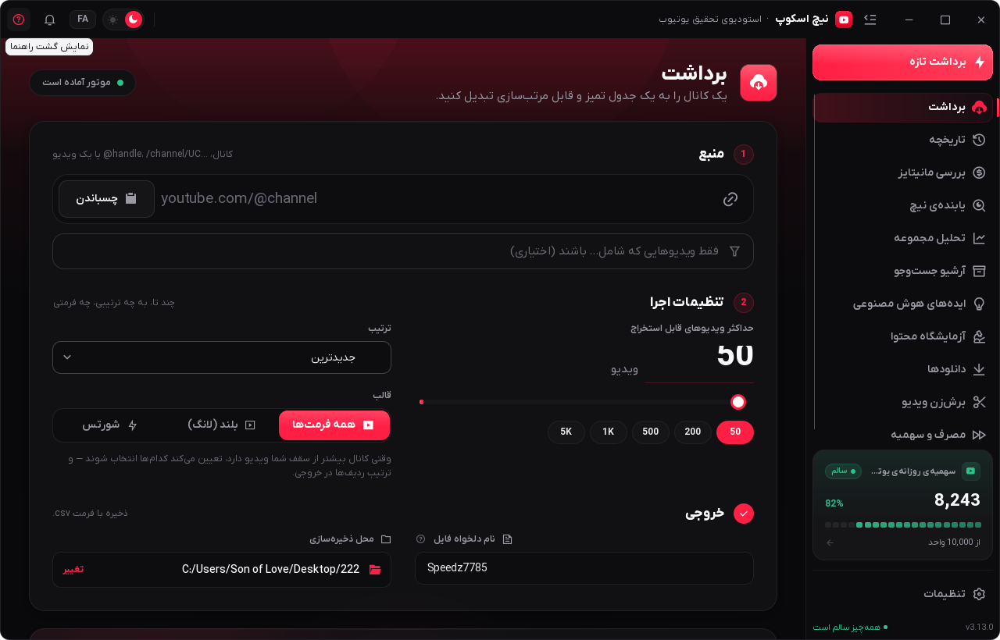
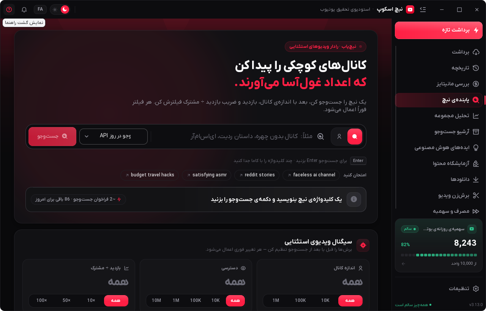
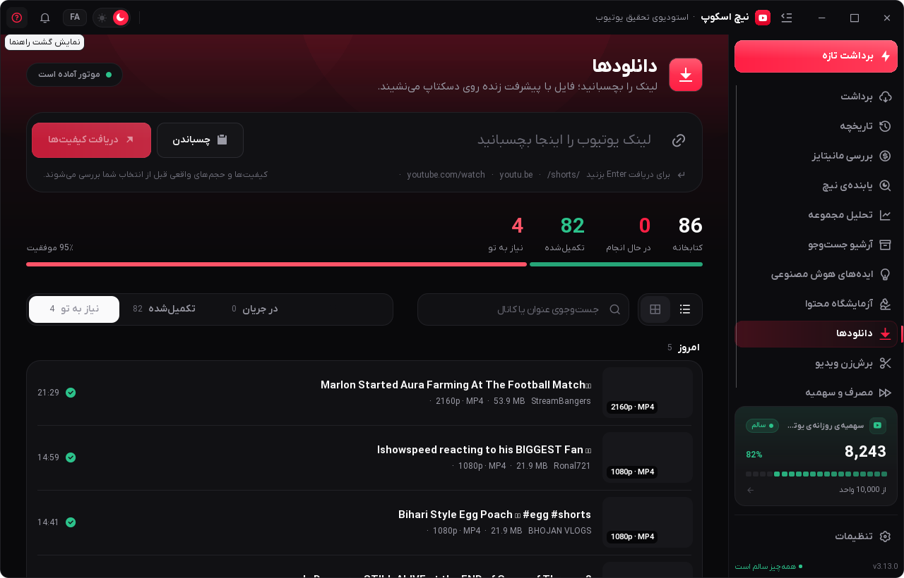
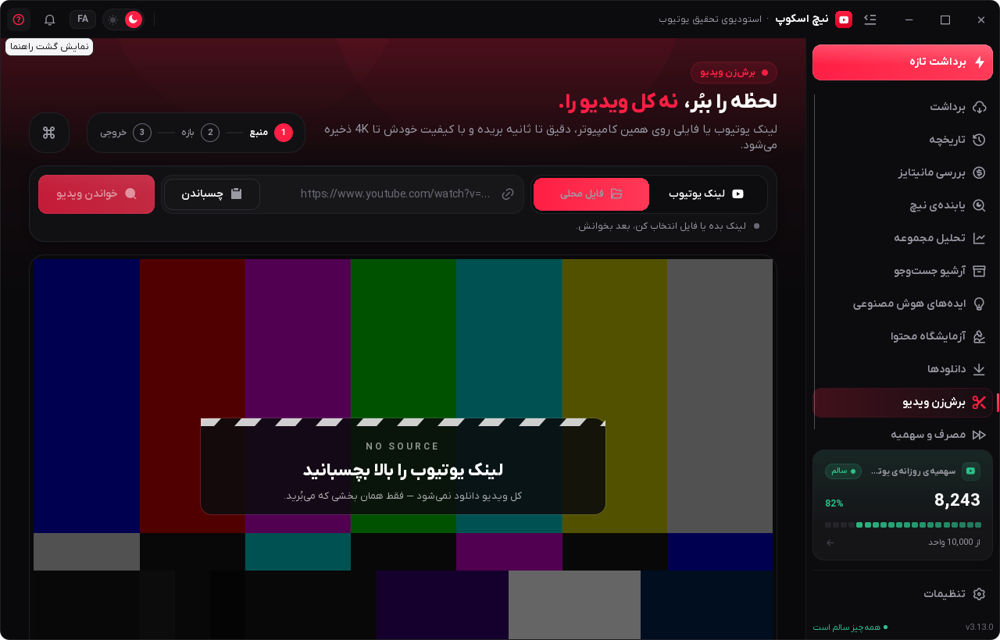
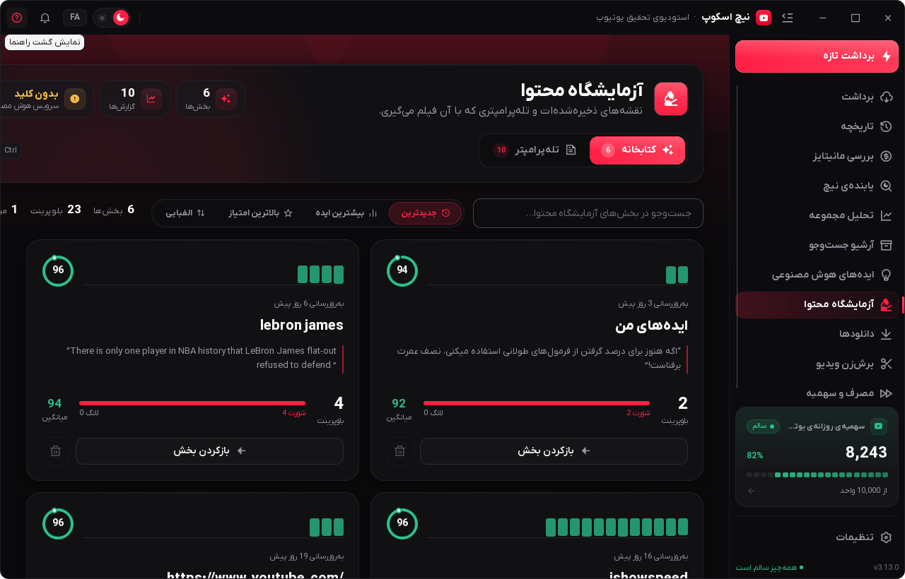
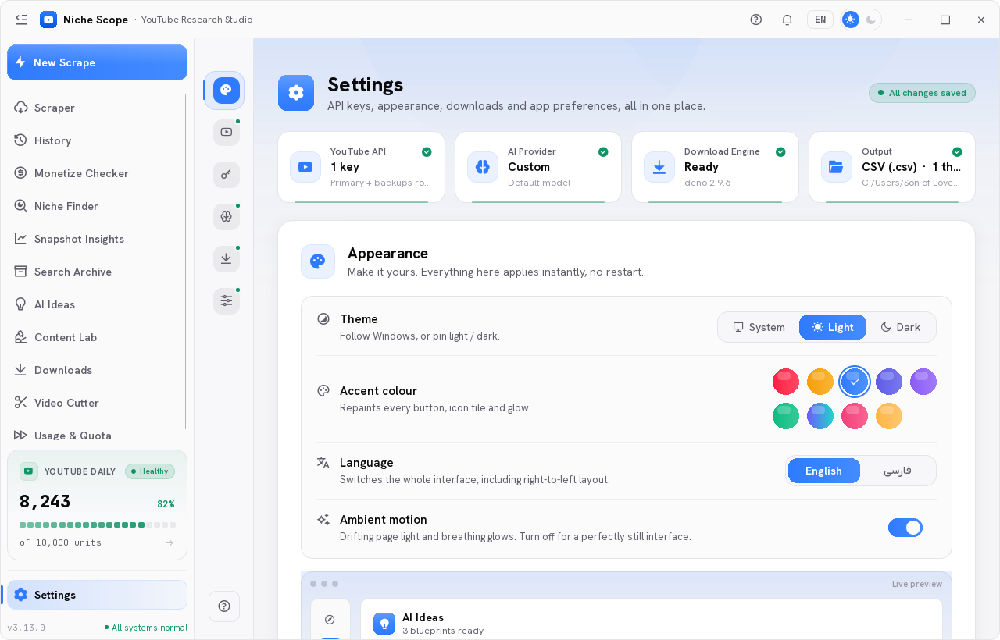
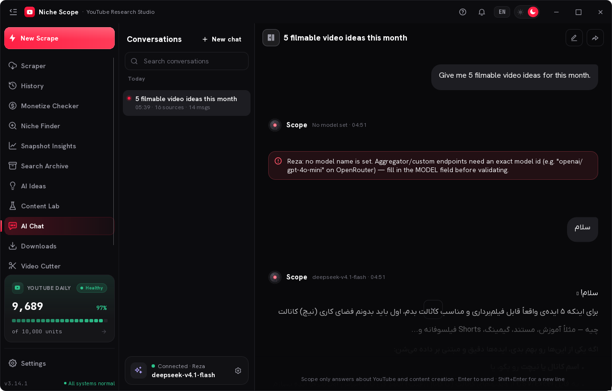

<div align="center" dir="rtl">


# یوتیوب هانتر

**تحقیق یوتیوب، پیدا کردن ویدیوهای پرتِ بازده، دانلود و برش کلیپ — یک اپلیکیشن ویندوز، به‌علاوهٔ یک دکمه داخل خودِ یوتیوب.**

**فارسی** · [English](README.md) · [نصب و راه‌اندازی](docs/INSTALL.md) · [افزونهٔ مرورگر](docs/EXTENSION.md)


-0ea5e9?style=flat-square)


</div>

---

<div dir="rtl">

یوتیوب هانتر یک میز کار دسکتاپ برای کسانی است که کانال یوتیوب می‌گردانند. یک کانال یا یک کلیدواژه به آن می‌دهی: داده را می‌کشد بیرون، ویدیوهایی را پیدا می‌کند که نسبت به **میانگین خودِ آن کانال** بازده بالاتری دارند، از برنده‌ها بریف محتوایی می‌سازد، هرچه لازم داری با کیفیت دلخواه دانلود می‌کند و کلیپ‌ها را می‌بُرد — بدون یک مرورگر پر از تب و یک فایل اکسل.

برنامهٔ بومی ویندوز است (پایتون + Qt Quick/QML) و همه‌چیز روی سیستم خودت اجرا می‌شود: کلید API، دانلودها و آرشیو، همه محلی می‌مانند. یک **افزونهٔ کروم/اِج** هم کنارش هست که همان پنل دانلود و برش را روی خودِ صفحهٔ یوتیوب می‌آورد و کار را برنامهٔ دسکتاپ در پس‌زمینه انجام می‌دهد.

</div>

<div align="center">

</div>

## نصب

<div dir="rtl">

۱. از بخش **[آخرین نسخه](../../releases/latest)** فایل **`YouTubeHunter-Setup.exe`** را دانلود کن.
۲. اجرا کن. نصب **برای همان کاربر** در `%LOCALAPPDATA%\Programs\YouTube Hunter` انجام می‌شود — بدون رمز ادمین، بدون UAC، و چیزی در `Program Files` نوشته نمی‌شود.
۳. برنامه را از منوی Start یا شورتکات دسکتاپ باز کن.

بدون پایتون، بدون pip، بدون Visual C++ و بدون اینترنت هم **نصب و اجرا** می‌شود: کل موتور برنامه (~۱۷۰ مگابایت) داخل نصب‌کننده است، از جمله موتور جاوااسکریپت و دستیار PO Token که دانلود یوتیوب لازم دارد.

> **SmartScreen:** نصب‌کننده امضای دیجیتال ندارد، پس ویندوز ممکن است بار اول پیام *«Windows protected your PC»* بدهد: **More info → Run anyway**.

راهنمای کامل نصب، اجرای اولیه و رفع اشکال: **[docs/INSTALL.md](docs/INSTALL.md)**

</div>

## اجرای اول

<div dir="rtl">

برنامه روی صفحهٔ **Scraper** باز می‌شود و یک تور کوتاه نشان می‌دهد (دکمهٔ `?` در نوار عنوان دوباره اجرایش می‌کند).

- **کلید YouTube Data API:** برای قابلیت‌های وابسته به یوتیوب به یک کلید **YouTube Data API v3** نیاز داری (رایگان از [Google Cloud Console](https://console.cloud.google.com/apis/library/youtube.googleapis.com)). در **Settings → API** بچسبانش و **Validate** بزن. کلید محلی ذخیره می‌شود و فقط به گوگل فرستاده می‌شود.
- **سرویس هوش مصنوعی (اختیاری):** در **Settings → AI Providers** گوگل جمینی، OpenAI یا هر سرویس سازگار با OpenAI را اضافه کن. هیچ بخشی از برنامه به آن وابسته نیست.
- **زبان و تم:** **Settings → Appearance** → انگلیسی/فارسی (RTL کامل)، تیره/روشن، پنج رنگ اکسنت. همه برای همان کاربر ذخیره می‌شود.

همه‌چیز محلی است: `%APPDATA%\YoutubeScrapperCyber\` کانفیگ، کلیدها، آرشیو SQLite و `crash.log` را نگه می‌دارد. حذف برنامه عمداً به داده‌هایت دست نمی‌زند.

</div>

## دکمهٔ Hunter روی یوتیوب

<div dir="rtl">

افزونه (Chrome/Edge، Manifest V3) کنار Like/Share یک دکمهٔ **Hunter** اضافه می‌کند — در صفحهٔ ویدیو و در Shorts:

- **تب دانلود:** کیفیت‌های واقعی با حجم واقعی، فرمت ویدیو (MP4 / MKV / WEBM)، فرمت صدا (MP3 / M4A / OPUS / WAV / FLAC) و **ترک صدا** (اصلی یا هر دوبله). ردیف انتخاب‌شده به کپسول زنده تبدیل می‌شود: درصد، سرعت، حجم، زمان باقی‌مانده، مکث/ادامه، و در پایان Play / نمایش در پوشه.
- **تب برش:** In/Out روی خط‌کش زوم‌شده (یا تایم‌کد تایپ‌شده)، خروجی ویدیو یا فقط-صدا؛ فقط همان تکه دانلود و بریده می‌شود.
- **دنبال کردن کار:** پنل را ببند یا تب را عوض کن — **کارت فعالیت زندهٔ** دسکتاپ تا پایان کار ادامه را نشان می‌دهد.
- **اجرای خودکار برنامه:** اگر برنامه بسته باشد، با کلیک روی Hunter از طریق پروتکل `youtubehunter://` (ثبت‌شده توسط نصب‌کننده) **کوچک‌شده** اجرا می‌شود.

**نصب افزونه:** پوشهٔ `browser-extension` داخل پوشهٔ نصب برنامه است. در `chrome://extensions` گزینهٔ **Developer mode** را روشن کن، **Load unpacked** را بزن و همان پوشه را انتخاب کن. اولین کلیک، مرورگر می‌پرسد *«Open YouTube Hunter?»* — تیک **Always allow** را بزن.

راهنمای کامل: **[docs/EXTENSION.md](docs/EXTENSION.md)**

</div>

## قابلیت‌ها

<div dir="rtl">

### تحقیق

| | |
|---|---|
| **اسکرپر کانال و کلیدواژه** | کاتالوگ یک کانال یا نتیجهٔ جست‌وجو را با کنترل سهمیه، مرتب‌سازی و ادامه‌دادن می‌گیرد؛ عمق اسکرپ قابل تنظیم است. |
| **تشخیص Outlier** | هر ویدیو را با میانگین خودِ آن کانال می‌سنجد، پس ویدیوهای ۳ تا ۳۰ برابر دیده می‌شوند، نه فقط پربازدیدترین‌ها. |
| **Niche Finder** | یک موضوع را بین کانال‌ها می‌گردد، وقتی فیلترها نتیجه نمی‌دهند جست‌وجو را خودکار بازتر می‌کند و کانال‌های ارزشمند را رتبه می‌دهد. |
| **آرشیو جست‌وجو** | هر اسکرپ در SQLite محلی ذخیره می‌شود؛ بدون مصرف دوبارهٔ سهمیه فیلتر، مرتب و تحلیل کن. |
| **Snapshot Insights** | بریف کانال (ریتم انتشار، فرمت، طول، الگوی عنوان، وجه مشترک Outlierها) + نمای **Dossier** با نوار اطمینان، نیت، سیگنال‌ها و آزمایش‌ها. |

### ساخت

| | |
|---|---|
| **AI Ideas** | از یک Outlier ایدهٔ ویدیو با قلاب و زاویه می‌سازد، با سرویس هوش مصنوعی خودت. |
| **Content Lab** | طرح چهاربخشی (قلاب → ساختار → بیت‌ها → CTA) و خروجی PDF استایل‌دار، فارسی یا انگلیسی. |
| **چت هوش مصنوعی** | روی داده‌های خودت: تحلیل بریف ذخیره‌شده، تا **۵۰ لینک یک‌جا**، پرسش دربارهٔ یک کانال یا ویدیو. |
| **بررسی Monetization** | قبل از سرمایه‌گذاری روی یک نیش/کانال، تخمین می‌زند که ارزشش را دارد یا نه. |

### تولید

| | |
|---|---|
| **دانلود** | کیفیت‌های واقعی، فقط-صدا، زیرنویس، تامنیل، انتخاب کانتینر و فرمت صدا، **انتخاب ترک صدا/دوبله**، مکث و ادامه، و زنجیرهٔ تلاش مجدد کلاینت‌ها با کوکی مرورگر. |
| **برش‌زن** | برش دقیق با پیش‌نمایش زنده، stream-copy برای سرعت یا re-encode برای دقت، خروجی ویدیو (MP4/MKV/WEBM) یا صدا (MP3/M4A/OPUS/WAV/FLAC)، فایل محلی هم پشتیبانی می‌شود. |
| **ترنسکریپت** | دو موتور استخراج با پشتیبانی پروکسی و کوکی. |
| **کارت فعالیت زنده** | دانلود یا برش را شروع کن و به برنامهٔ دیگری برو — کارتی در گوشهٔ صفحه پیشرفت، سرعت و زمان باقی‌مانده را نشان می‌دهد و در پایان سبز می‌شود. |
| **گارد اتصال** | خودِ یوتیوب را تست می‌کند (نه لیست کشورها)، هر ۶۰ ثانیه دوباره می‌سنجد و لحظه‌ای که VPN قطع شود صفحهٔ گیت را باز می‌کند. |

### خود برنامه

- **انگلیسی و فارسی** — رابط کامل RTL، در هر لحظه قابل تغییر، با فونت وزیر برای فارسی.
- **تم تیره و روشن**، پنج رنگ اکسنت، ذخیره‌شده برای هر کاربر.
- **نصب برای همان کاربر، بدون ادمین، بدون نیاز به پایتون** — نصب‌کننده کل رانتایم را دارد.
- **همه‌چیز محلی** — کانفیگ، آرشیو و دانلودها روی سیستم خودت می‌مانند؛ کلیدهای API در Settings وارد می‌شوند و جایی نمی‌روند.

</div>

## تصاویر

| Niche Finder | دانلودها |
|---|---|
|  |  |

| برش‌زن | Content Lab |
|---|---|
|  |  |

| تنظیمات | چت هوش مصنوعی |
|---|---|
|  |  |

## ویندوزهای پشتیبانی‌شده

<div dir="rtl">

| | |
|---|---|
| **ویندوز ۱۱** | ✅ ۶۴ بیتی، همهٔ نسخه‌ها |
| **ویندوز ۱۰** | ✅ ۶۴ بیتی، **نسخهٔ ۱۸۰۹ (build 17763) یا جدیدتر** |
| **ویندوز ۸.۱ / ۷** | ❌ پشتیبانی نمی‌شود (رانتایم Qt 6 حداقل ویندوز ۱۰ ۱۸۰۹ می‌خواهد) |
| **ویندوز ۳۲ بیتی** | ❌ پشتیبانی نمی‌شود — بیلد فقط x64 است |
| **ویندوز روی ARM** | ⚠️ با شبیه‌سازی x64 اجرا می‌شود، تست نشده |
| **مک / لینوکس** | ❌ برنامه فقط ویندوز است |

</div>

## ساخت از سورس

<div dir="rtl">

پیش‌نیاز: **Python 3.11+ (۶۴ بیتی)** روی ویندوز، و [Inno Setup 6](https://jrsoftware.org/isdl.php) برای ساخت نصب‌کننده.

</div>

```bat
git clone https://github.com/reyzodev/youtube-hunter.git
cd youtube-hunter
build.bat
```

<div dir="rtl">

`build.bat` یک محیط ایزوله (`.build-venv`) می‌سازد، وابستگی‌ها را نصب می‌کند، همهٔ ورودی‌های بیلد را قبل از PyInstaller چک می‌کند، بیلد را با `YoutubeScrapper.spec` می‌گیرد، خروجی را بررسی می‌کند و در آخر `installer.iss` را کامپایل می‌کند:

```
dist\YouTubeHunter\YouTubeHunter.exe     خود برنامه (onedir — کل پوشه را بفرست)
Output\YouTubeHunter-Setup.exe           نصب‌کننده
```

سه فایل باینری به‌خاطر حجم در ریپو نیستند و `build.bat` نبودنشان را با پیام واضح گزارش می‌دهد:

| فایل | حجم | چرا لازم است |
|---|---|---|
| `assets/bin/ffprobe.exe` | ~۱۴۵ مگ | دانلود mp3/فقط-صدا، بررسی فایل محلی در برش‌زن، و probe کیفیت |
| `assets/bin/deno.exe` | ~۹۳ مگ | موتور جاوااسکریپت که yt-dlp برای حل چالش دانلود یوتیوب لازم دارد |
| `assets/bin/bgutil-pot.exe` | ~۴۵ مگ | دستیار PO Token — بخش **اجباری** موتور دانلود؛ بدون آن یوتیوب روی IPهای VPN/دیتاسنتر فقط لیست ۳۶۰p می‌دهد یا ۴۰۳ می‌بندد. مجوز GPL-3.0، به‌صورت برنامهٔ جدا (`assets/bin/bgutil-pot-NOTICE.txt`) |

اجرای بدون بیلد:

</div>

```bat
python -m venv .venv
.venv\Scripts\pip install -r requirements.txt
.venv\Scripts\python main_qml.py
```

## ساختار پروژه

```
main_qml.py               نقطهٔ شروع — بریج‌ها را می‌سازد و QML را لود می‌کند
app/
  qml/                    رابط: Main.qml + pages/ + components/
  qml_backend/            ViewModelهایی که QML با آن‌ها حرف می‌زند (شامل web_bridge برای افزونه)
  core/                   منطق اصلی: API یوتیوب، جست‌وجوی نیش، برش، هوش مصنوعی، دانلود
  ui/                     آیکون‌ها، فونت‌ها، تم
  locales/fa.py           رشته‌های فارسی (متن انگلیسی خودش کلید است)
browser-extension/        دکمهٔ Hunter (Manifest V3)
fonts/                    فونت‌های فارسی و لاتین
assets/                   آیکون‌ها، لوگو، آیکون نصب‌کننده (bin/ کامیت نمی‌شود)
docs/                     نصب، افزونه، یادداشت بیلد، چنج‌لاگ فارسی
screenshots/              تصاویر رابط
tools/                    لینت‌های توسعه (hover-flicker، آیکون‌ها)
YoutubeScrapper.spec      دستور PyInstaller (حدود ۷۵ مگ Qt بلااستفاده را هم حذف می‌کند)
installer.iss             اسکریپت Inno Setup (برنامه + افزونه + پروتکل)
```

## مستندات

- [`docs/INSTALL.md`](docs/INSTALL.md) — نصب، اجرای اول، افزونه، رفع اشکال (انگلیسی + فارسی)
- [`docs/EXTENSION.md`](docs/EXTENSION.md) — دکمهٔ Hunter از صفر تا آخر (انگلیسی + فارسی)
- [`docs/BUILD.md`](docs/BUILD.md) — یادداشت‌های بیلد و بسته‌بندی
- [`docs/CHANGES-fa.md`](docs/CHANGES-fa.md) — چنج‌لاگ کامل فارسی، نسخه به نسخه
- [`CHANGELOG.md`](CHANGELOG.md) — خلاصهٔ انگلیسی

## نسخه

<div dir="rtl">

**۱.۰.۰** — اولین نسخهٔ عمومی: تحقیق و تشخیص Outlier، بریف هوش مصنوعی، دانلود با انتخاب ترک صدا، برش‌زن دقیق، کارت فعالیت زنده، و دکمهٔ Hunter داخل یوتیوب.

</div>

## مجوز

<div dir="rtl">

اختصاصی — © ۲۰۲۶ YouTube Hunter. همهٔ حقوق محفوظ است.
این ریپازیتوری برای مرجع، توزیع و پشتیبانی برنامه منتشر شده است؛ بازتوزیع نسخهٔ کامپایل‌شده یا نسخه‌های تغییریافته بدون اجازهٔ کتبی مجاز نیست.

اجزای ثالث باندل‌شده مجوز خودشان را دارند: `bgutil-pot` با GPL-3.0 (فایل `assets/bin/bgutil-pot-NOTICE.txt`) و FFmpeg / deno / PySide6 / Qt با مجوزهای خودشان داخل نصب‌کننده.

</div>
