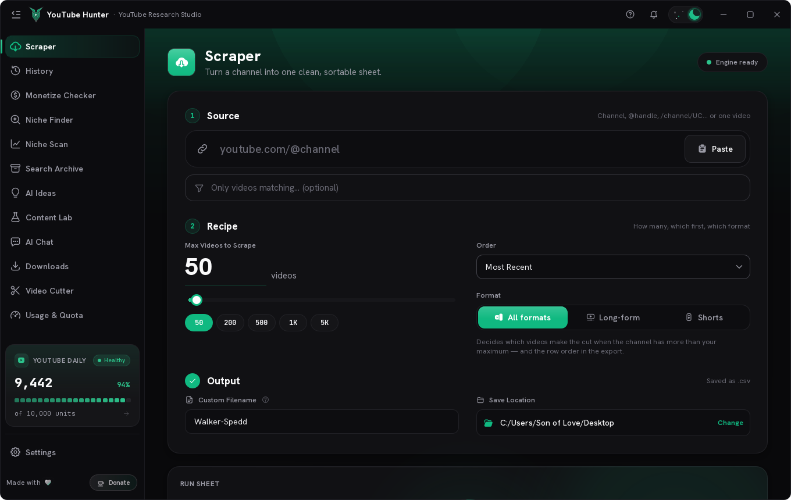
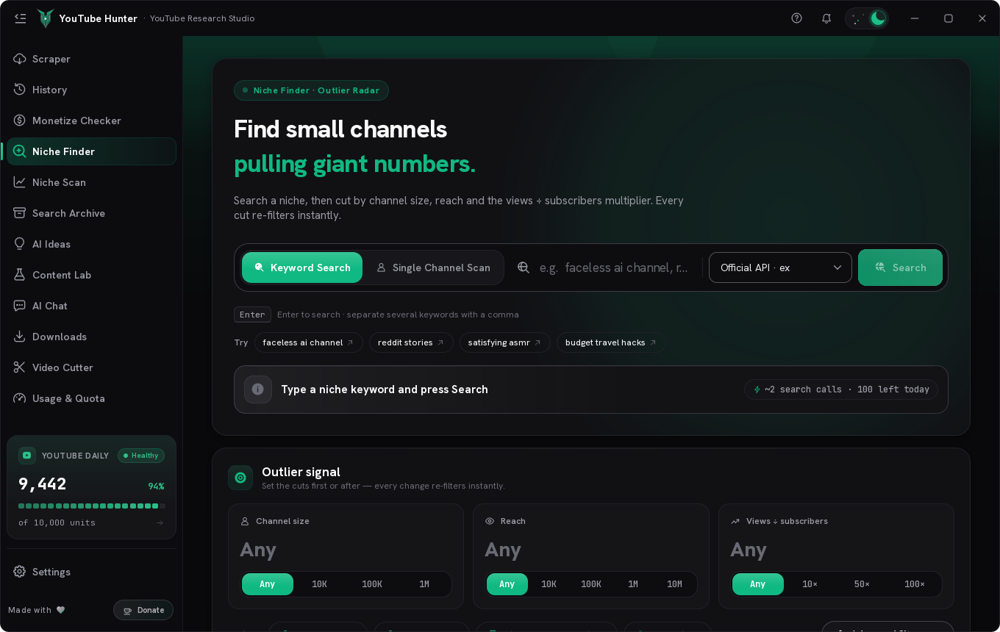
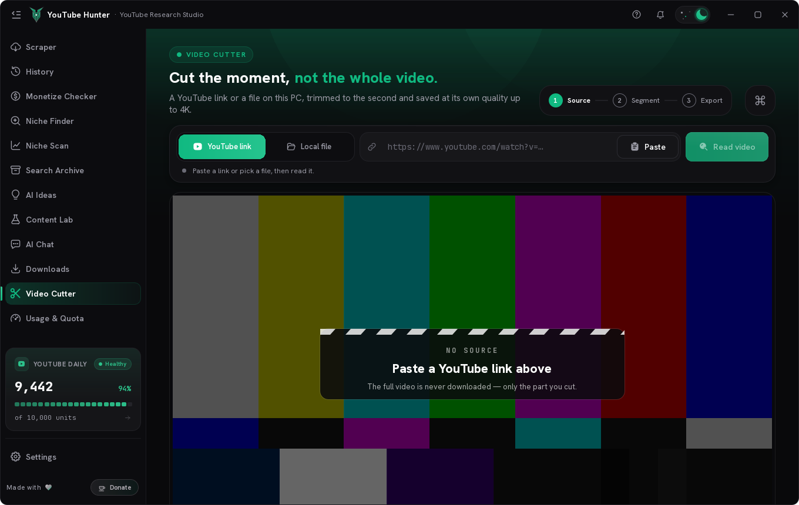
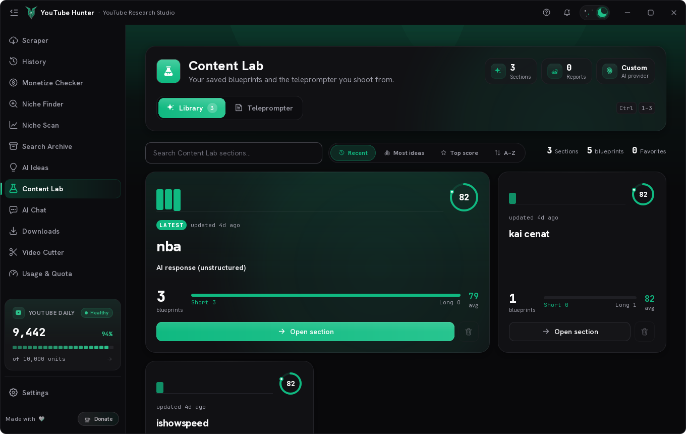
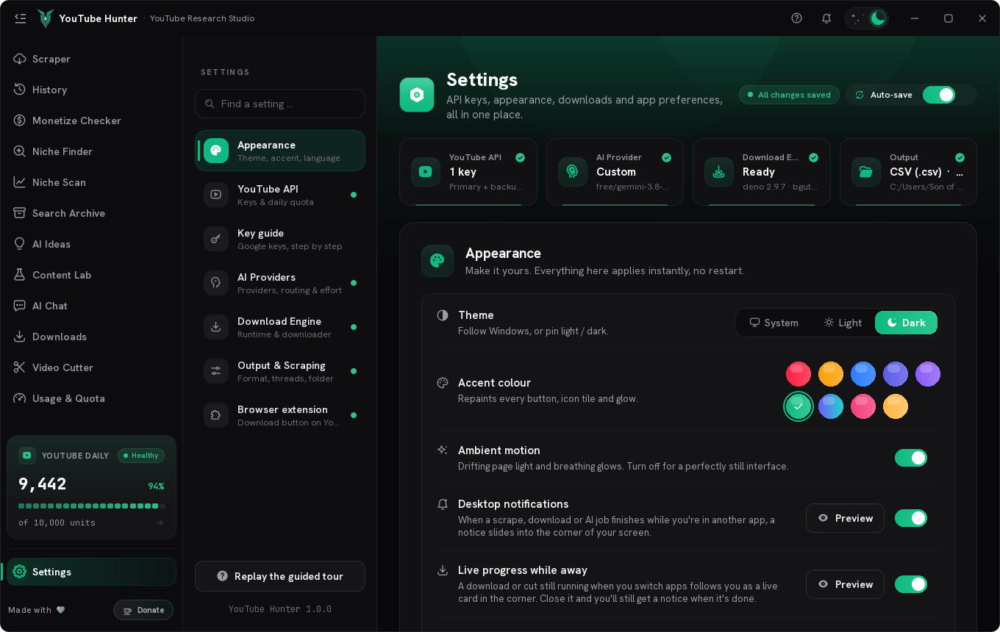
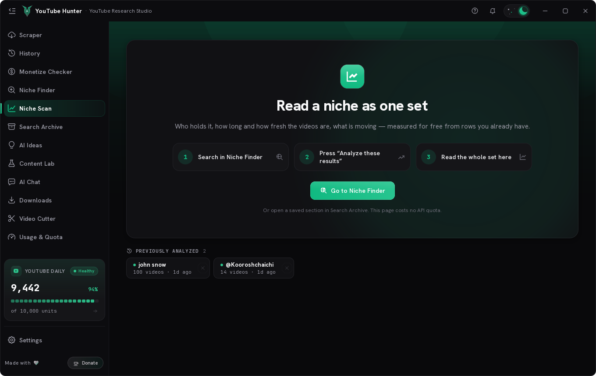

<div align="center">


# YouTube Hunter

**YouTube research, outlier detection, downloads and clip cutting — one Windows desktop app, plus a button inside YouTube itself.**

[Install](docs/INSTALL.md) · [Browser extension](docs/EXTENSION.md) · [Build from source](#build-from-source) · [Changelog](CHANGELOG.md)


-0ea5e9?style=flat-square)


</div>

---

YouTube Hunter is a desktop workspace for people who run YouTube channels. Point it at a channel or a keyword: it pulls the data, finds the videos that **over-perform** their own channel, turns the winners into a content blueprint, downloads what you need at the quality you want, and cuts the clips — without a browser full of tabs and a spreadsheet.

It is a native Windows application (Python + Qt Quick/QML). Everything runs on your machine: your API key, your downloads, your archive. A companion **Chrome/Edge extension** puts the same download and cut panel on the YouTube page itself, and the desktop app does the work in the background.

<div align="center">

</div>

## Download & install

1. Open the **[latest release](../../releases/latest)** and download **`YouTubeHunter-Setup.exe`**.
2. Run it. It installs **per user** in `%LOCALAPPDATA%\Programs\YouTube Hunter` — no administrator prompt, no UAC, nothing written to `Program Files`.
3. Launch **YouTube Hunter** from the Start menu or the desktop shortcut.

No Python, no pip, no Visual C++ redistributable and no internet connection is needed to install or start the app: the whole runtime ships inside the installer (~170 MB), including the JavaScript runtime and the PO Token helper that YouTube downloads need.

> **SmartScreen:** the installer is not code-signed, so Windows may show *"Windows protected your PC"* the first time. Choose **More info → Run anyway**. A code-signing certificate is the only way to remove that prompt.

Full walkthrough, first-run setup and troubleshooting: **[docs/INSTALL.md](docs/INSTALL.md)**.

### First run

The app opens on the **Scraper**. To use the YouTube-powered features you need a **YouTube Data API v3 key** (free from [Google Cloud Console](https://console.cloud.google.com/apis/library/youtube.googleapis.com)) — paste it in **Settings → API**. AI features are optional: add a provider (Google Gemini, OpenAI, or any OpenAI-compatible endpoint) in **Settings → AI Providers**.

Everything is stored locally: `%APPDATA%\YoutubeScrapperCyber\` holds your config, API keys and the SQLite archive. Uninstalling deliberately leaves it alone.

## The Hunter button (browser extension)


A Chrome/Edge extension (Manifest V3) adds a **Hunter** button next to Like/Share on any YouTube watch page and in Shorts:

- **Download** — real qualities with real sizes, video format (MP4 / MKV / WEBM), audio format (MP3 / M4A / OPUS / WAV / FLAC), and the **audio track** (original or any dub). The selected row turns into a live capsule: percent, speed, size, ETA, pause/resume, and Play / Show in folder when it finishes.
- **Cut** — mark In / Out on a zoomed ruler (or type a timecode), pick a quality or audio-only output, and only that clip is downloaded and cut. Progress is live; the clip lands in the app's Cutter history with its own card.
- **Follows you** — close the panel or switch tabs and the desktop **live activity card** takes over until the job finishes.
- **Starts the app for you** — if the desktop app isn't running, clicking Hunter launches it through the `youtubehunter://` protocol (registered by the installer), minimised.

The extension talks to the app over a local JSON server on `127.0.0.1:47391`. Only requests carrying the extension origin **and** the `X-YTH-Bridge` header are accepted, so no website can start a download. Set `"browser_bridge": false` in the config to turn the bridge off entirely.

Step-by-step install (30 seconds): **[docs/EXTENSION.md](docs/EXTENSION.md)**.

## Features

### Research

| | |
|---|---|
| **Channel & keyword scraper** | Pulls a channel's catalogue or a search query, with quota-aware pacing, sorting and continuation. Depth is adjustable — a quick look or a full sweep. |
| **Outlier detection** | Scores every video against the channel's own baseline, so the 3×–30× videos surface instead of the ones with the most views. |
| **Niche Finder** | Searches a topic across channels, widens the query automatically when a filter would return nothing, and ranks the channels worth studying. |
| **Search Archive** | Every scrape is stored locally in SQLite — revisit, filter, sort and re-analyse without spending quota again. |
| **Snapshot Insights** | A channel brief: cadence, formats, length, title patterns, what the outliers have in common — plus a saved **Brief (Dossier)** view with confidence bands, intent, signals and experiments. |

### Creation

| | |
|---|---|
| **AI Ideas** | Turns an outlier into concrete video ideas with hooks and angles, using your own model provider. |
| **Content Lab** | Builds a four-part blueprint (hook → structure → beats → CTA) and exports it as a styled PDF. |
| **AI Chat** | A chat panel wired to the data you already scraped: analyse a saved brief, drop in up to 50 links at once, ask about a channel, a niche or a single video. |
| **Monetization checker** | Estimates whether a niche or channel is worth the effort before you commit to it. |

### Production

| | |
|---|---|
| **Downloads** | Quality presets, audio-only, subtitles, thumbnails, container and audio-format choice, **audio-track / dub selection**, pause & resume, and a client-ladder retry chain with optional browser cookies for YouTube's per-client throttling. |
| **Video Cutter** | Frame-accurate cutting with a live preview, stream-copy for speed or re-encode for exactness, output as video (MP4/MKV/WEBM) or audio (MP3/M4A/OPUS/WAV/FLAC), local files too, and drag the result straight out to Explorer, Premiere or Telegram. |
| **Transcripts** | Two extraction engines (library + yt-dlp fallback) with proxy/cookie support, for scripting and AI analysis. |
| **Live activity cards** | Start a download or a cut, switch to another app — a card in the corner of the screen keeps showing progress, speed and ETA, then turns green when it lands. |
| **Connection guard** | Checks that YouTube is actually reachable (not just that the internet works), re-tests every minute, and reopens the gate the moment a VPN drops — downloads never half-fail silently. |

### The app itself

- **English interface**, dark and light themes, five accent colours, all remembered per user.
- **Per-user install, no admin rights, no Python required** — the installer carries the whole runtime.
- **Everything local** — config, archive and downloads stay on your machine; API keys are entered in Settings and never leave it.

## Screenshots

| Niche Finder | Video Cutter |
|---|---|
|  |  |

| Content Lab | Settings |
|---|---|
|  |  |

| Niche Scan | Scraper |
|---|---|
|  |  |

## Supported Windows

| | |
|---|---|
| **Windows 11** | ✅ 64-bit, all editions |
| **Windows 10** | ✅ 64-bit, **version 1809 (build 17763) or newer** |
| **Windows 8.1 / 7** | ❌ not supported (the bundled Qt 6 runtime requires Windows 10 1809+) |
| **32-bit Windows** | ❌ not supported — the build is x64-only |
| **Windows on ARM** | ⚠️ runs under x64 emulation, untested |
| **macOS / Linux** | ❌ the app is Windows-only (uses Win32 APIs for the frameless window, taskbar and notifications) |

## Build from source

Requirements: **Python 3.11+ (64-bit)** on Windows, and [Inno Setup 6](https://jrsoftware.org/isdl.php) if you want the installer.

```bat
git clone https://github.com/reyzodev/youtube-hunter.git
cd youtube-hunter
build.bat
```

`build.bat` creates an isolated `.build-venv`, installs the pinned dependencies, verifies every build input, runs PyInstaller with `YoutubeScrapper.spec`, verifies the output, and then compiles `installer.iss`:

```
dist\YouTubeHunter\YouTubeHunter.exe     the app (onedir — ship the whole folder)
Output\YouTubeHunter-Setup.exe           the installer
```

Three binaries are **not** in this repository because of their size, and `build.bat` stops and tells you if they are missing:

| File | Size | Why it is needed |
|---|---|---|
| `assets/bin/ffprobe.exe` | ~145 MB | mp3/audio-only downloads, the cutter's local-file probe, quality probing |
| `assets/bin/deno.exe` | ~93 MB | the JavaScript runtime yt-dlp needs to solve YouTube's download challenge |
| `assets/bin/bgutil-pot.exe` | ~45 MB | the PO Token helper — a **required** part of the download engine; without it YouTube serves a 360p-only list or 403 on VPN/datacenter IPs. GPL-3.0, bundled unmodified as a separate program (see `assets/bin/bgutil-pot-NOTICE.txt`) |

Run it without building:

```bat
python -m venv .venv
.venv\Scripts\pip install -r requirements.txt
.venv\Scripts\python main_qml.py
```

## Project layout

```
main_qml.py               entry point — builds the bridges, loads QML
app/
  qml/                    the interface: Main.qml + pages/ + components/
  qml_backend/            the ViewModels the QML talks to (incl. web_bridge for the extension)
  core/                   the actual logic: YouTube API, niche search, cutter, AI, downloads
  ui/                     icons, fonts, theme helpers
browser-extension/        the Hunter button (Manifest V3: content.js, panel.css, background.js)
fonts/                    bundled fonts
assets/                   icons, logo, installer icon (bin/ is not committed)
docs/                     install, extension, build notes, release notes
screenshots/              current UI
tools/                    developer lints (hover-flicker checker, icon art)
YoutubeScrapper.spec      PyInstaller recipe (also trims ~75 MB of unused Qt)
installer.iss             Inno Setup script (bundles the app, the extension, the URL protocol)
```

## Tech stack

| Layer | What |
|---|---|
| UI | Qt Quick / QML (Qt 6.12), PySide6, custom design tokens, no web views |
| Logic | Python 3.13, SQLite (local archive), `yt-dlp`, FFmpeg |
| APIs | YouTube Data API v3, `youtube-transcript-api`, Google Gemini / OpenAI-compatible providers |
| Extension | Chrome/Edge Manifest V3, vanilla JS + CSS, local JSON bridge on `127.0.0.1:47391` |
| Packaging | PyInstaller (onedir) + Inno Setup (per-user install) |

## Docs

- [`docs/INSTALL.md`](docs/INSTALL.md) — install, first run, extension setup, troubleshooting
- [`docs/EXTENSION.md`](docs/EXTENSION.md) — the Hunter button, end to end
- [`docs/BUILD.md`](docs/BUILD.md) — build and packaging notes
- [`CHANGELOG.md`](CHANGELOG.md) — release notes

## Version

**1.0.0** — research, outlier detection, AI briefs, downloads with audio-track selection, a frame-accurate cutter, live activity cards, and the Hunter button inside YouTube.

## License

Proprietary — © 2026 YouTube Hunter. All rights reserved.
This repository is published for reference, distribution and support of the app. Redistribution of the compiled application, or of modified versions of it, requires written permission.

Bundled third-party components keep their own licences: `bgutil-pot` is GPL-3.0 (see `assets/bin/bgutil-pot-NOTICE.txt`), and FFmpeg / deno / PySide6 / Qt are distributed under their respective licences inside the installer.
